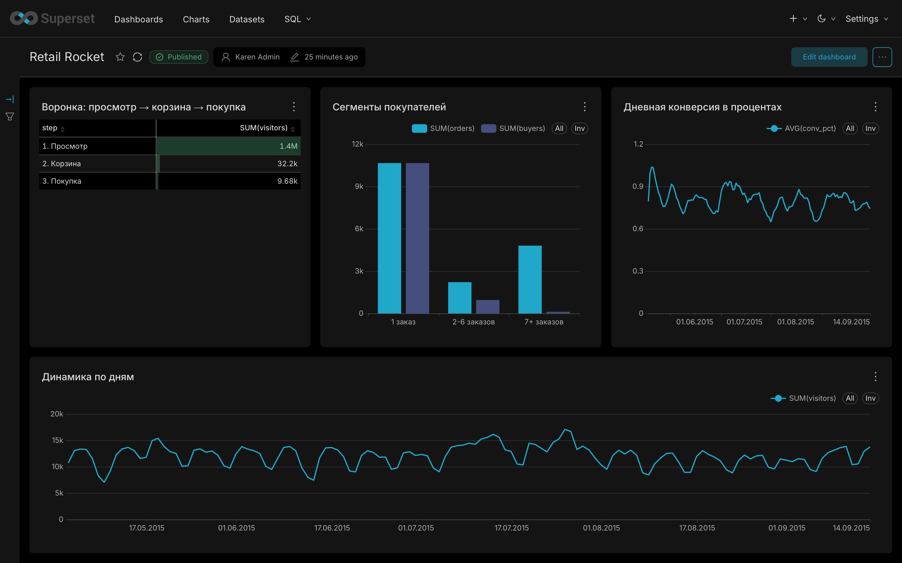

# Продуктовая аналитика e-commerce: от SQL до дашборда и гипотез

Сквозной учебный проект на реальных данных интернет-магазина (Retail Rocket): очистка данных, воронка и продуктовые метрики в SQL, проверка гипотез на Python, дашборд в Apache Superset и автоматически собираемый Excel-отчёт.



## Ключевые выводы

- **Воронка** (строгая, с учётом порядка шагов): 1 404 018 посетителей → 32 243 в корзину (**2,30%**) → 9 682 купили (**30,03%** от корзины). Общая конверсия просмотр → покупка **0,69%**.
- **Выходные хуже будней:** конверсия «посетитель-день → покупка» 0,623% против 0,866% (разность 0,243 п.п., 95% ДИ 0,213-0,272).
- **Глубина просмотра связана с действием:** посетители, просмотревшие 2+ товара до первого действия, добавляют в корзину или покупают в 2,5 раза чаще (4,52% против 1,84%; разность 2,68 п.п., 95% ДИ 2,60-2,76). Результат устойчив к определению окна наблюдения: при фиксированном 24-часовом окне 4,19% против 1,66%.
- **Решение о покупке принимается быстро:** медиана времени от первого просмотра до покупки 21 минута, 80,8% покупок в течение суток, p90 около 8 дней. Напоминания о корзине имеет смысл отправлять в первые часы и сутки.
- **Заказы сконцентрированы:** 112 покупателей (0,96%) с 7+ заказами дают 27,2% всех заказов. Заказов на покупателя 1,51 в целом и 1,19 без этого сегмента, поэтому «средний покупатель» в отчётах нужно показывать с разбивкой по сегментам.
- **Удержание низкое:** 71% посетителей делают одно событие и не возвращаются; ретеншен 1-й недели для типичной когорты около 4,8%.

Связи в данных наблюдательные, причинность не доказана. Проверка потребует A/B-теста (например, блок рекомендаций для увеличения глубины просмотра).

## Данные

[Retail Rocket e-commerce dataset (Kaggle)](https://www.kaggle.com/datasets/retailrocket/ecommerce-dataset): события посетителей интернет-магазина (`view`, `addtocart`, `transaction`).

- 2 756 101 событие, 1,41 млн посетителей, 235 тыс. товаров, 17 672 заказа
- Период: 03.05.2015 - 18.09.2015
- Используются `events.csv` и `category_tree.csv`. Сами файлы в репозиторий не включены (см. `.gitignore`), скачайте их с Kaggle в папку `data/`.

## Стек

PostgreSQL 16, DBeaver, Python (pandas, scipy, statsmodels, SQLAlchemy, xlsxwriter), Jupyter, Apache Superset (Docker), Excel, Git.

## Качество данных

| Проверка | Результат |
|---|---|
| Дубликаты | 460 точных дублей (0,017%), только в `view` (94) и `addtocart` (366); удалены, результат в `events_clean` (2 755 641 строка) |
| Логика `transactionid` | заполнен только у событий `transaction` |
| Неполнота трекинга | 1 143 из 11 719 покупателей (9,8%) без записанной корзины, 428 (3,7%) без просмотров; 70 посетителей имеют только событие покупки |
| Края периода | 03.05 и 16-18.09 неполные, исключены из анализа динамики |
| Аномалии | 11-12 и 24-26.07: рост трафика при падении конверсии, причина не установлена |
| Краулеры | правило: 100+ событий, 0 заказов, 99%+ просмотров; под него попали 161 посетитель (1,45% событий). Исключение не меняет воронку (2,30% и 30,03% против 2,30% и 30,00%) |

В заказе в среднем 1,27 товарной строки, поэтому покупки считаются по `DISTINCT transactionid`, а не по числу строк.

## Методология

- Воронка считается по **посетителям**, а не по событиям. Строгая версия требует правильного порядка шагов (просмотр → корзина → покупка по первому событию).
- Признаки глубины просмотра считаются **только до первого действия** (корзина или покупка), чтобы избежать круговой логики: покупка сама порождает события.
- Сегмент «оптовики» выделен по порогу p99 распределения заказов на покупателя (7+ заказов) и показывается отдельно, а не удаляется.
- Статистика: z-тест для двух долей, доверительные интервалы для разности. При такой выборке p-value ничтожно мало, поэтому интерпретация опирается на размер эффекта и интервал (p < 0,001).

## Ограничения

- `visitorid` это, вероятнее всего, cookie: смена устройства или очистка cookie создаёт «нового» посетителя, что занижает ретеншен.
- Нет цен и выручки в `events.csv`, поэтому средний чек не считается.
- Окно данных около 4,5 месяцев, у покупателей последних дней пути «не доехали» до покупки (цензурирование справа).
- Строки «посетитель-день» в проверке H2 не независимы, доверительный интервал немного занижен.

## Структура репозитория

```
├── README.md
├── data/                  
├── sql/
│   ├── 01_data_quality.sql
│   ├── 02_funnel.sql
│   ├── 03_dynamics_cohorts.sql
│   ├── 04_outliers.sql
│   ├── 05_journey.sql
│   ├── 06_weekend.sql
├── notebooks/
│   └── hypotheses.ipynb   # проверка гипотез H1, H2
├── scripts/
│   └── build_report.py    # автоматическая сборка Excel-отчёта
├── dashboards/            # экспорт Superset (zip) и скриншот
└── reports/               # пример Excel-отчёта
```

## Как воспроизвести

1. Установите PostgreSQL, создайте базу `retailrocket` и таблицы `events`, `category_tree`, загрузите CSV командой `\copy`.
2. Выполните SQL-файлы из `sql/` по порядку (они создают `events_clean`, `visitor_flags`, `visitor_journey` и вью для дашборда).
3. Для гипотез: `pip install pandas numpy scipy statsmodels sqlalchemy psycopg2-binary`, затем откройте `notebooks/hypotheses.ipynb`.
4. Для Excel-отчёта: `pip install xlsxwriter` и `python scripts/build_report.py`. Адрес базы можно задать переменной окружения `DB_URL`.
5. Дашборд: запустите Superset через Docker Compose, подключите базу (`host.docker.internal:5432`), импортируйте файл из `dashboards/`.

## Дашборд

Воронка, динамика посетителей и конверсии по дням (со скользящим средним), сегменты покупателей. Экспорт из Superset лежит в `dashboards/`.

## Идеи для развития

- A/B-тест рекомендаций с расчётом размера выборки и мощности
- Когортный ретеншен в виде тепловой карты в Superset
- Анализ категорий товаров по `category_tree`
